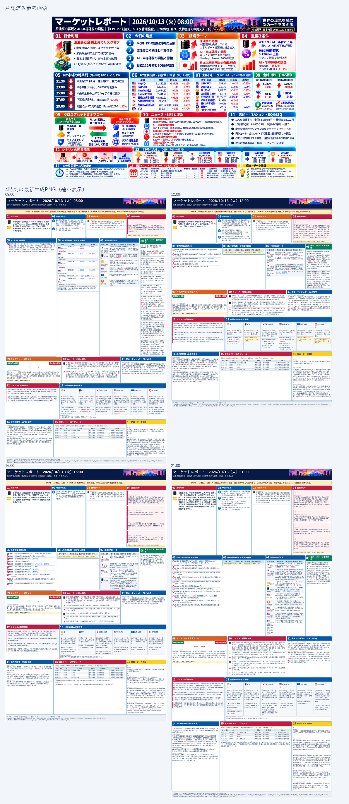

# PR #97 acceptance evidence — 2026-10-14

**Disposition: historical 4-slot previews are not formally accepted; fresh-report pipeline passes locally; visual design remains pending.** The October 13 images are `DEBUG_PREVIEW` artifacts for visual review only. They carry source/snapshot warnings and do not restore withdrawn reports.

## Four generated PNGs

| Slot | PNG | Dimensions | Receipt | Visual review |
|---|---|---:|---|---|
| 08:00 | [preview PNG](review-20261014-design-final/2026-10-13_08-00/png/preview-2026-10-13_08-00.png) | 1536 × 2539 | `PASS`; numeric validation `UNVERIFIED`; `DEBUG_PREVIEW` | Six primary market rows are kept together; panel 8 now carries risk/volatility series; still much taller than reference |
| 12:00 | [preview PNG](review-20261014-design-final/2026-10-13_12-00/png/preview-2026-10-13_12-00.png) | 1536 × 2001 | `PASS`; numeric validation `UNVERIFIED`; `DEBUG_PREVIEW` | Missing panel 6 shrinks to its unavailable marker; several other large gaps remain |
| 16:00 | [preview PNG](review-20261014-design-final/2026-10-13_16-00/png/preview-2026-10-13_16-00.png) | 1536 × 2408 | `PASS`; numeric validation `UNVERIFIED`; `DEBUG_PREVIEW` | Six primary markets and risk data are separated; still much taller than reference |
| 21:00 | [preview PNG](review-20261014-design-final/2026-10-13_21-00/png/preview-2026-10-13_21-00.png) | 1536 × 3137 | `PASS`; numeric validation `UNVERIFIED`; `DEBUG_PREVIEW` | Highest density and height; some narrow market tables remain hard to scan at page scale |

The generated panels retain the approved 16-panel order, place the event schedule in panel 15, use high-contrast colored bands, keep six primary market tiles together, group volatility/sentiment series in panel 8, and distinguish the two cross-asset flow directions. Missing panel 6 content now collapses to its unavailable marker. Visual acceptance remains **PENDING**: compared with the 1536 × 1024 approved reference, these outputs remain substantially taller; the reference uses larger pictograms and more evenly filled illustrated cards. Panel 4 does not reproduce the reference's three illustrated risk conditions, and small table text is less readable at a fitted-page scale. Browser PASS does not resolve these design differences.

## Historical source and snapshot investigation

The four October 13 reports are not formally reproducible from the evidence recovered. GitHub history does preserve one on-window 12:00 market snapshot, but it has no canonical report-body/identity/spec link:

| Slot | Source evidence | Snapshot/spec disposition |
|---|---|---|
| 08:00 | Git acquisition history records recovery at 11:37:42 JST, 307.7 minutes after the scheduled 06:30 fetch. No canonical report exists at that commit or current main. | The stored snapshot is late, not an 08:00 original. Report identity/spec remain missing; withdrawn content was not restored. |
| 12:00 | Git commit `76cf749` preserves a verified no-fallback snapshot generated at 11:34:12 JST (blob `8b093c6285f4154f249b99bd53f768fc67d3c7f2`). Current history was later replaced by an 18:34:55 recovery snapshot. No canonical report exists at the original acquisition commit or current main. | On-window market snapshot is recoverable, but original body/revision/hash/spec link is not. The later snapshot and reconstructed review body are not accepted as original. |
| 16:00 | Canonical report has revision `1791875571770` and bodyHash `5fdc2e936ad7b60d7c3ca4bb4c8963a729a27d43d6dd6d4b33492d542dde3e17`. Slot-labelled snapshots were generated at 18:19:41 and 23:28:05 JST; no snapshot identity is bound to the canonical body. | Body identity exists, but the matching historical snapshot/spec envelope is missing. Later snapshot data is not substituted. |
| 21:00 | Git acquisition/snapshot record is generated at 23:05:42 JST, after the report slot. No canonical report exists at that commit or current main. | Later market history is not a 21:00 original. Report body identity/spec remain missing; withdrawn content was not restored. |

The time-specific 08:00, 16:00, and 21:00 snapshot versions found in current history were acquired after their slots; the 12:00 on-window snapshot is recoverable only from an older Git blob, without its report-body identity link. No later prices were backfilled into the October 13 reports, and withdrawn source documents were not restored. The remaining recovery requirement is the original pre-render acquisition payload plus its immutable report identity, body hash, spec, and revision linkage from the original generator/archive or provider history. If that evidence no longer exists, the affected historical output remains unrecoverable as a formal source report.

Detailed Git object and run-log evidence: [`HISTORICAL-SNAPSHOT-AUDIT-20261013.md`](../../project-control/0800-design/HISTORICAL-SNAPSHOT-AUDIT-20261013.md).

## Fresh-report formal-generation trial

A new October 14 16:00 DRAFT was generated from a new acquisition payload. Its TEST ONLY source was copied into [isolated test evidence](review-20261014-design-final/new-report-test/source-report.json) and removed from the canonical `reports/` directory so publication-index rebuilds cannot ingest a test report. All six required symbols were verified at acquisition; no required values were missing and no fallback was used. Sixteen secondary-symbol acquisition errors were recorded. The typed snapshot, revision-1 identity, and body hash were bound at report creation, and G0/G1/G2 passed.

The first `validate_spec` run exposed three generator/validator contract mismatches: number cards treated change and percent as current prices, narrative numbers lacked precise source-line provenance, and numbered panel headings did not match required-section aliases. These were fixed without relaxing the source lock or snapshot-value checks. Market price/change/change-percent fields now bind separately to the typed snapshot; other body numbers bind to exact source-section line hashes; numbered headings are normalized before the existing required-section comparison. Regression cases reject changed source-line hashes and check each market field. The same new report then passed `validate-infographic-spec` with 30 structured panels and 49 unique numeric values and generated a source-bound prompt.

The approved-layout DRAFT render also passed with a current Git source at commit `a019887aac2c33a7d32fb7ba3ec013972d8863af`. Its local `panel-manifest.json`, `numeric-registry.json`, `source-lock.json`, `preflight.json`, render contract, and [test PNG](review-20261014-design-final/new-report-test/png/preview-2026-10-14_16-00.png) are included. The renderer reported no overflow, no out-of-panel content, and no card overlaps. It remains `DEBUG_PREVIEW`; numeric validation is `UNVERIFIED`, `publish_allowed=false`, and the publication manifest is `NOT_CREATED`. Event rows in this pipeline-only body deliberately contain no market-event data, so this proves report/spec/render connection but not real event ingestion. G3/G4, Drive/Portal readback, and external publication were not run.

## Verification

- Python `unittest discover -s tests -q`: **PASS, 240 tests** before latest-main integration; after integrating main `931dd9b53a04b85a32ee59a8ca61bf4a3fb51188`, `unittest discover -s tests`: **PASS, 250 tests**. Publication consistency, all 164 indexed reports, canonical parity, and `build_reports.py` no-rewrite stability also **PASS** after isolating the TEST ONLY source from canonical history.
- Independent publication-path, Apps Script infographic gate, and 16:00 source recovery fail-closed regression tests: **PASS**.
- Hosted checks on PR head `ed781827f9915617146ba4548774f5390d617682`: **6/6 success** (`preflight` ×2, `test`, `approved-layout-review`, `publication-contract`, `validate`). Annotations were runner notices only: Node.js 20 action deprecation and the scheduled ubuntu-latest image migration; no code or gate failure was reported.
- Four Edge render receipts: **PASS** for browser layout/render diagnostics; no rendered overflow or card overlaps in the stored receipts. The receipts label numeric validation `UNVERIFIED` and artifact type `DEBUG_PREVIEW`.
- Source/snapshot audit for historical reports: **BLOCKED** by missing original snapshot/identity evidence as detailed above.
- Fresh-report G0/G1/G2, report/body and market validation, spec validation, source lock, prompt generation, and approved-layout DRAFT renderer: **PASS**. Local panel manifest created; publication manifest **NOT_CREATED** by design.
- Human visual comparison against approved reference: **NOT ACCEPTED**; differences remain.
- Formal manifest integration, Drive/Portal readback, physical-device review: **NOT_RUN**.
- Existing publication-stop and validation gates were not relaxed. PR remains Draft/Open; no merge, production publication, or Google Drive save was performed.
- Latest main `931dd9b53a04b85a32ee59a8ca61bf4a3fb51188` is integrated into this PR branch at merge commit `b4422cac20987b2eb2dfc970995478afb01ff62a`. Conflict resolution keeps the strict complete-dashboard copy and all FR-15–FR-19 identity/history protections; the Saturday/Sunday no-new-publication rule remains enforced. PR-branch push does not run the main-only publication/deployment workflows.
- The TEST ONLY source JSON is now isolated under the test-evidence directory. A post-move `build_reports.py` stability run discovered 164 canonical files and made no worktree changes; the report was not left in publishable canonical history.

## Next necessary work

1. Resolve the 08:00 content/approved-geometry fit conflict without shrinking text or dropping information, then produce and compare only the 08:00 candidate. Do not propagate the design to the other three slots before 08:00 visual approval.
2. Exercise event ingestion in a fresh report with event data bound to verified primary sources; the current pipeline test intentionally has no real event entries.
3. Recover original pre-slot source snapshots and immutable report identity evidence from source archives if available. Keep unrecoverable slots explicitly blocked.
4. Treat Drive/Portal readback and publication manifest as separate external work after explicit authorization; do not publish this PR branch.

## 2026-10-14 continuation — 16:00 E2E body identity and 08:00-only design gate

### Production 16:00 body mismatch

Read-only comparison of the ChatGPT report message to the current Google Docs body confirms they are not the same text. After removing Markdown presentation, whitespace, and citation markers, the normalized lengths are 5,174 characters for ChatGPT and 4,219 for Docs; the first substantive differences appear at the preamble and in the first section. ChatGPT's opening sentence under `1．総合判断` (“今日の最大の特徴は、日経平均の後場急反転です。”) is absent from the Doc, which begins directly with the market-price paragraph. The exact internal writer call is not exposed, so the proven boundary is the ChatGPT-to-Docs handoff, not a specific script.

The ChatGPT task's final-state text says GitHub body registration did not occur. `reports/2026-10-14_16-00.json` is absent from main (404), and `data/latest-report.json` remains 2026-10-13 16:00. This is a missing canonical registration, not an observed mismatch against a 10/14 GitHub canonical body. Drive revision 1 contained only a BOM; revision 7 contains the current body. No source body hash/snapshot envelope in that production task is available to prove an identical write/render/publish transaction.

Latest-main acquisition history adds a verified 16:00-labeled market snapshot generated at 16:30:22 JST (commit `68562b0`, blob `ea9bea4d96d9be7c3cb9622fd1e67fc8e10f6189`). The Google Docs readback revision was already present at 16:06:16 JST, and the history file was subsequently overwritten by a 21:13 recovery fetch. Main also records a Japanese close-reference package generated at 21:50:35 JST with `complete=false`. There is no receipt tying either later data package to the ChatGPT body, so neither is treated as its source snapshot. The TEST ONLY fixture remains separate.

Detailed evidence: [`E2E-20261014-1600-DIAGNOSIS.md`](../../project-control/0800-design/E2E-20261014-1600-DIAGNOSIS.md).

### Fresh TEST ONLY report identity check

The isolated new-report TEST ONLY input and local approved-layout preview carry the same `report_id`, revision, `snapshot_id`, and `bodyHash`. The render contract is `PASS` for a `DEBUG_PREVIEW`, with `publish_allowed=false`; no publication manifest was created. This proves local report-to-render identity only. It does not prove Google Docs readback, real publication manifest creation, GitHub registration, or production generation. The test-only source remains outside canonical report history.

### 08:00 fixed reference fit

The latest instruction restricts design work to 08:00 until visual approval. The current 08:00 output remains a rejected 1536×2539 baseline against the 1536×1024 reference. The exact reference rectangles are fixed in the layout specification. A 14px Meiryo width-aware estimate finds a minimum of 3,320 excess body characters across panels 06 (+264), 07 (+613), 08 (+638), 10 (+97), 11 (+39), 12 (+152), 13 (+719), 14 (+269), 15 (+178), and 16 (+351). A simpler optimistic area model gives a lower 2,241-character total, confirming that these are model-dependent lower-bound estimates, not exact browser clipping counts. Both omit required icon/table space, arrows, row gaps, and larger heading text. No 08:00 candidate is claimed complete because the complete current text does not fit the fixed rectangles under either optimistic model at 14px. Visual acceptance remains `PENDING`; 12:00, 16:00, and 21:00 design outputs were not changed in this continuation.

Detailed geometry, method, panel count, estimates, and overlay: [`REFERENCE-FIXED-FIT-ANALYSIS-20261014.md`](../../project-control/0800-design/REFERENCE-FIXED-FIT-ANALYSIS-20261014.md), [`overflow-estimates.json`](../../../validation/0800-reference-fixed-analysis-20261014/overflow-estimates.json), [`fit-calculation.json`](../../../validation/0800-reference-fixed-analysis-20261014/fit-calculation.json), and [overlay of the rejected 08:00 baseline](../../../validation/0800-reference-fixed-analysis-20261014/reference-overlay-existing-08-rejected-baseline.png).

No Drive writes, production publication, main merge, or gate weakening occurred.

## 08:00 diagram-only summary revision — 2026-10-14 23:29 JST

The original full report remains byte-for-byte stored in the preview package. The diagram is now a separate 59-claim source-bound summary and still covers all 16 reference panels. It gives priority to the decision basis, important news, cross-asset flow caveat, scenario triggers, six market outlooks, handoff checks, and risk conditions; secondary details remain in the complete input body. References include source offsets, actual line numbers, section numbers, and excerpts. Numeric token/unit and critical-role coverage checks run, with human semantic review mandatory.

The new 08:00 PNG is 1536×1024 and uses the reference's exact 16 panel rectangles, order, and width ratios. Detailed panel differences and review limits are in [`08:00 difference list`](summary-preview-0800-review6/difference-list.md); the original/reference side-by-side is [`comparison image`](summary-preview-0800-review6/comparison/side-by-side.png), the 50% overlay is [`overlay`](summary-preview-0800-review6/comparison/overlay-50pct.png), and the candidate is [`08:00 PNG`](summary-preview-0800-review6/png/preview-2026-10-13_08-00-summary.png).

The historical source is marked withdrawn and lacks `report_id`, `revision`, `snapshot_id`, `bodyHash`, and a linked verified snapshot. Its exact body bytes are preserved, but the report is not restored as canonical and the PNG is not a formal report. Formal generation is `NOT_READY`; publication remains stopped with `publish_allowed=false`. The render overflow report is empty within Pillow line-wrap scope only; browser rendering/inter-claim overlap and physical-device readability were not run. Human review of meaning, omitted rationale/risk, added facts, and visual fidelity remains `PENDING`.

Local regression: Python 261/261; Node independent publication path PASS; renderer JS syntax and `git diff --check` PASS. No new design was applied to 12:00/16:00/21:00. PR remains OPEN/Draft; no main merge, production publication, or Drive write.
